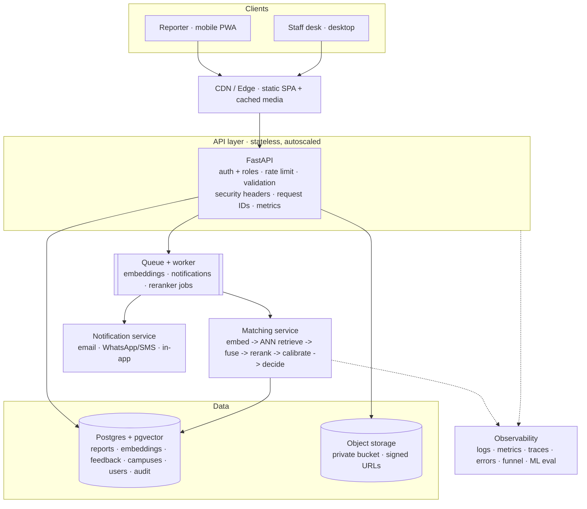

# Architecture

> Companion to [`DEVELOPMENT_PLAN.md`](DEVELOPMENT_PLAN.md). This document
> describes how the system is put together **today** and where it is heading.

## What this is

An **Intelligent Lost & Found Object Matching System**: students and staff report
lost or found belongings with a description and/or a photograph, and the system
ranks the most likely counterparts using visual, textual, temporal and location
evidence — and says *"no confident match"* rather than guessing.

## Module map (current)

```
lostfound/
  settings.py    NEW (Phase 0)  the only reader of the environment
  db.py          Phase 2        SQLAlchemy engine factory; SQLite fallback and PostgreSQL/psycopg URL handling
  config.py                     re-exports resolved values from settings
  logging.py     NEW (Phase 0)  structured logs + request-id middleware
  api.py         FastAPI: campus, reports, extract, match, feedback, stats, signed media, static UI
  objects.py     local/S3-compatible private photo storage and expiring signed URLs
  auth.py        Supabase Auth client; deps.py resolves database-backed roles
  ratelimit.py   Redis-backed sliding windows and login-failure lockout
  moderation.py  honeypot, minimum-time and link-only report checks
  middleware.py  CSP and browser security headers
  cli.py         campus / seed / stats / match / demo / eval / feedback / serve
  campus.py      buildings, floors, walking graph, Dijkstra
  taxonomy.py    categories, colours, brands, damages, marks, locations
  schema.py      canonical attribute schema (shared by vision + text)
  textnorm.py    free text -> attributes
  imagery.py     deterministic synthetic item photos
  corpus.py      simulated three weeks of reports + ground truth
  embedders.py   offline text/image embedders + real-model adapters
  features.py    pair measurement, scoring, explanations
  matching.py    ranking + match/review/no_match decision
  retrieval.py   PostgreSQL pgvector HNSW candidate shortlist before feature scoring
  features.py    pair evidence and bounded 4096-entry parsing/token caches
  eval.py        recall@k, MRR, nDCG, precision@alert, distractor rate
  store.py       runtime repository: SQLite demo or PostgreSQL/pgvector via SQLAlchemy connection pool
  pipeline.py    corpus -> enriched reports -> embeddings -> DB
  colorspace.py  hex <-> Lab, perceptual distance, palette naming
  timeutil.py    timezone-safe timestamp parsing at the API boundary

web/             React + Vite + Leaflet single-page UI (map, feed, form, match view)
migrations/      Alembic baseline plus additive revisions through 0008; SQLite-tested, PostgreSQL runtime validation pending
scripts/         SQLite-to-PostgreSQL idempotent backfill and local data utilities
tests/           pytest suite; test_migrations/test_settings/test_logging added in Phase 0
```

## Target architecture



### The five moves that get there

1. **SQLite file → Postgres + pgvector**, with Alembic owning the schema.
2. **Full matcher rebuild per write → ANN retrieval + incremental updates.**
3. **Synchronous everything → a queue** for embeddings, notifications and
   re-ranker training.
4. **Local `data/media` → private object storage** with signed, expiring URLs.
5. **One campus → `campuses` with scoped pools** and a campus-admin role.

Each is owned by a phase in `DEVELOPMENT_PLAN.md`: (1) Phase 2, (2) Phase 2,
(3) Phase 2, (4) Phase 2, (5) Phase 6.

The pgvector retrieval path is implemented in `retrieval.py`; `Matcher.rank`
selects it when the application is configured with a PostgreSQL database URL.
SQLite remains the default and uses exhaustive candidate scoring. Live
PostgreSQL query-plan and recall validation are still required.

API report reads, matching, feedback, and statistics are scoped to the
authenticated user's campus. New or previously unassigned accounts and
anonymous traffic use `DEFAULT_CAMPUS_ID`; legacy reports without a campus ID
are assigned to that default scope.
Timestamp values are emitted and persisted as canonical UTC ISO strings.
Legacy naive values are converted once using the report campus timezone, or
`DEFAULT_CAMPUS_TIMEZONE` when the campus has no record. PostgreSQL-native
`timestamptz` columns and absolute-time rendering in each campus timezone
remain outstanding; the current UI displays relative times.

### Photo storage status

New uploads use a local private filesystem backend by default or an optional
S3-compatible backend. Local media URLs are HMAC-signed and expire after five
minutes; S3 URLs are presigned GET requests with the same expiry. Existing
`data/media` paths remain readable through the signed local endpoint. The
bucket's private access policy is configured by the operator, and bulk upload
of legacy media to S3 remains outstanding.

## Decision log

Short ADR-style entries. Add one whenever a choice would be expensive to reverse.

### ADR-0001 — Postgres + pgvector as the target store, SQLite for the demo
**Status:** accepted (runtime migration remains in progress)
**Context.** The prototype ships on a single SQLite file so it runs with no
external services. That does not survive concurrency or national scale, and
brute-force vector scoring in Python is O(corpus) per query.
**Decision.** Move the runtime to Postgres with the `pgvector` extension and an
HNSW index; keep `sqlite://` working as a zero-dependency demo path.
**Consequences.** `store.py` becomes a repository layer; the ad-hoc
`ALTER TABLE` block disappears; retrieval becomes an ANN prefilter over ~200
candidates. `store.py`'s schema was shaped like this from the start (one row per
`(report, kind, model)` vector), so the move is a translation, not a rewrite.

### ADR-0002 — `settings.py` is the only environment reader
**Status:** accepted (implemented in Phase 0)
**Context.** Configuration was hardcoded in `config.py`, so the same image could
not run in dev/staging/prod and nothing could be overridden without editing code.
**Decision.** A single pydantic-settings `Settings` object reads the process
environment and `.env`. `config.py` re-exports the resolved values under their
historical names so no call site had to change.
**Consequences.** 12-factor deploys work with no code edits. A test asserts
`config` never drifts from `settings`. Reviewers can reject any new
`os.environ` read outside `settings.py`.

### ADR-0003 — Alembic owns the schema from Phase 2
**Status:** accepted; scaffolding delivered in Phase 0
**Context.** `store.connect()` created tables with `CREATE TABLE IF NOT EXISTS`
plus ad-hoc `ALTER TABLE` migrations inline. There was no versioned history and
no way to roll a deployment back.
**Decision.** Alembic, with the database URL sourced from application settings.
**Consequences.** Revision `0001` is a frozen snapshot of today's schema and is
verified by test to produce byte-identical DDL to the SQLite `store.connect()`
schema. PostgreSQL startup requires the latest Alembic revision; the SQLite demo
still creates its local schema directly.

### ADR-0004 — A learned re-ranker must beat the hand-set weights
**Status:** proposed (Phase 3)
**Context.** Scoring weights in `features.py` are hand-set and documented. Staff
confirm/reject decisions already store the feature vector *and* probability at
decision time, so a training set exists but nothing consumes it.
**Decision.** Train a LightGBM LambdaMART re-ranker on the exported labels, with
the synthetic corpus for cold start, and publish an ablation table against the
hand-set baseline. Keep the baseline selectable as a fallback.
**Consequences.** The claim "intelligent" becomes measurable. Requires careful
holdout-by-item splits and train/serve feature parity tests.

### ADR-0005 — Structured JSON logs with request correlation
**Status:** accepted (implemented in Phase 0)
**Context.** Nothing logged request latency or carried an identifier, so a
user-reported problem could not be traced to a log line.
**Decision.** One JSON object per line in production (readable text in dev), with
a per-request id stored in a `ContextVar`, echoed in the `X-Request-ID` header.
**Consequences.** Logs are greppable and parseable; Phase 9 adds metrics, traces
and error reporting on top of this skeleton.

### ADR-0006 — Supabase Auth with database-backed application roles
**Status:** accepted (Phase 1)
**Context.** Staff actions need verified identities, and roles must not be
self-assigned through signup metadata or trusted from an access-token claim.
**Decision.** Supabase owns passwords, access tokens and refresh sessions. The
application verifies bearer tokens with Supabase and reads the current role
from its own `users` table on each privileged request. Public registration
always creates a `student`; an operator assigns elevated roles with
`lostfound --db <path> auth set-role <user-id> <role>`.
**Consequences.** The app needs only the Supabase project URL and public anon
key, never the service-role key. Supabase Auth endpoints are unavailable until
those settings are supplied. Roles are stored in the configured application
database; PostgreSQL backfill support exists but has not been live-validated.

## Current limitations

Known and deliberate. Each has an owning phase.

| Limitation | Owning phase |
|---|---|
| PostgreSQL/pgvector runtime and Redis queue are implemented but have not been validated against live services | 2 |
| The SQLite demo still creates its local schema directly; PostgreSQL startup requires Alembic | 2 |
| The PostgreSQL repository uses a compatibility SQL adapter rather than a full ORM and has not been live-tested | 2 |
| Revisions through 0008 define pgvector/HNSW, campus-version, UTC-normalization, and affected-match indexing; migrations have only been exercised on SQLite so far | 2 |
| Matcher snapshots use per-campus database generations for cross-process invalidation; live multi-worker and affected-pair load validation remain outstanding | 2 |
| Cursor pagination and API page-size caps are implemented; SQLite remains the default runtime | 2 |
| Feature parsing/token caches are bounded to 4096 entries each and pass helper-level 10k-input and API 10k-request read soaks | 2 |
| Report claim verification is a stub; it does not yet complete a handover | 4 |
| Moderation uses lightweight heuristics; no CAPTCHA or trained classifier | 1 |
| The SPA keeps access/refresh tokens in memory and requires sign-in after a page reload | 1 |
| Supabase auth flow passed a live smoke test; repeat it when provider configuration changes | 1 |
| Redis command/error handling is unit-tested with a fake client; an optional live Redis integration test is available | 1 |
| Project paths derive from `PROJECT_ROOT` (the package location), which is why the Docker image installs the package **editable**; specifying paths explicitly would remove that coupling | 2 |
| `react-hooks/set-state-in-effect` is disabled: the four hits are legitimate external-sync effects that belong to the Phase 7 effects/data-layer pass | 7 |
| PostgreSQL migration and backfill are implemented but still need live database validation; app runtime remains SQLite | 2 |

## Verifying a change

`make check` runs everything CI runs: ruff lint + format-check, mypy, pytest,
eslint, prettier and `tsc`. The initial migration is covered by
`tests/test_migrations.py`, which asserts upgrade builds the schema, that the
schema matches `store.connect()`, and that downgrade removes every table.
